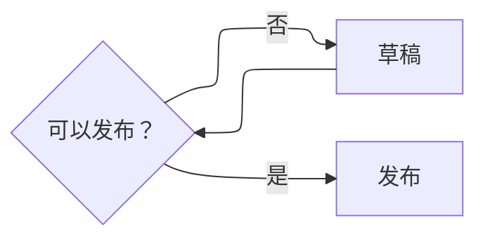

# 使用指南

## 安装

需要桌面版 Obsidian **1.13.7+**。

1. 从 [GitHub Releases](https://github.com/Zerokei/Litos-Companion/releases) 下载同一版本的 `main.js`、`styles.css` 和 `manifest.json`。
2. 在 Obsidian 库中创建 `.obsidian/plugins/litos-companion/`，将三个文件放入该目录。
3. 重新加载 Obsidian，在第三方插件设置中启用 Litos Companion。

## 主题显示

在 **设置 → Litos Companion → Litos 显示** 中选择二级标题靠左或靠右，默认靠右。设置同时应用于阅读模式与实时预览。

标题控制需要支持 Companion API 1 的 Litos 主题。旧版 Litos 或其他主题下，选择仍会保存，但暂停应用。插件不会替换已安装的主题文件；更新到提供该接口的 Litos 主题后即可生效。接口定义见 [架构与主题接口](architecture.md)。

## 图表增强

普通 `mermaid` 代码块由 Obsidian 内置渲染器显示。Obsidian 1.15 使用 Pele。在需要 ELK 的那张流程图中，将下面的配置放在代码块内部、`flowchart` 或 `graph` 声明之前。

删除这段配置即可恢复内置布局。ELK 会排列节点和连线，使用圆角卡片、虚线判断节点和胶囊形连线标签。

**设置 → Litos Companion → 图表增强 → 允许流程图使用 ELK** 默认开启。关闭后，整个库的图表都交给 Obsidian。升级时，旧版的「增强 Mermaid 流程图」开关会换成这个新选项，初始值为开启。原先靠旧开关增强的流程图需要在图内添加 `layout: elk` 才会继续使用 ELK。

图表颜色随当前主题变化；切换其他主题后，图表增强仍可使用。示例见 [示例笔记](../examples/验收示例.md)。

## 兼容范围

- 非流程图继续使用 Obsidian 内置渲染。
- 显式指定非 ELK 布局、非 classic 外观，或包含内部链接、click 交互、数学公式的流程图交给内置渲染。
- 增强使用 SVG 文字标签，支持普通文本和换行；不承诺任意 HTML 标签。
- ELK 渲染失败时使用 Obsidian 内置渲染器；源码本身无效时，仍会显示原始错误。
- 其他替换 Mermaid 渲染器的插件可能产生顺序冲突，不保证共同接管同一流程图。
- 所有依赖在本地运行，无 CDN、遥测或联网渲染服务。

关闭图表增强后恢复内置渲染；禁用插件后，标题恢复主题默认样式。

## Zen mode

在插件设置的“专注显示”中开启 Zen mode，或通过命令面板执行
“Litos Companion: 切换专注模式”。可在 Obsidian 快捷键设置中为此命令分配快捷键。

它隐藏 Ribbon、两侧侧栏切换按钮、文档导航与操作按钮、状态栏和新建标签加号，
保留标签页、路径及正文，不改变侧栏展开状态。再次执行命令或关闭设置即可退出。
设置会保存，插件停用时恢复界面。macOS 原生窗口红黄绿按钮不受此模式控制。

## 强调色

“Litos 显示 → 强调色”与当前仓库的 Obsidian 原生外观设置共享同一份配置，
无需另存插件配色。使用颜色选择器修改，右侧重置按钮恢复主题默认颜色。
停用插件不会撤销颜色修改。该入口使用经检查的 Obsidian 内部接口；
接口不可用时显示提示，请改用原生外观设置。

## 主题版本与自动适配

插件设置的“主题兼容性”会显示当前 Litos 版本、配套接口和检测结果。当前支持 Litos 1.1.3 或更新版本提供的接口 1。更新主题文件后若提示 CSS 与安装版本不一致，请重新加载主题或 Obsidian。

图表配色、字体以及可选的圆角和线宽跟随兼容主题的 CSS 变量；旧主题缺失变量时保持原来的默认效果。过旧或不支持的接口会暂停标题控制和 Litos 专用样式，通用 Mermaid 增强、Zen 与原生强调色设置仍可使用。插件不会自动下载或修改主题。
